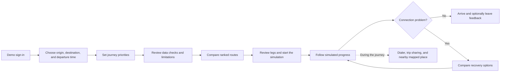
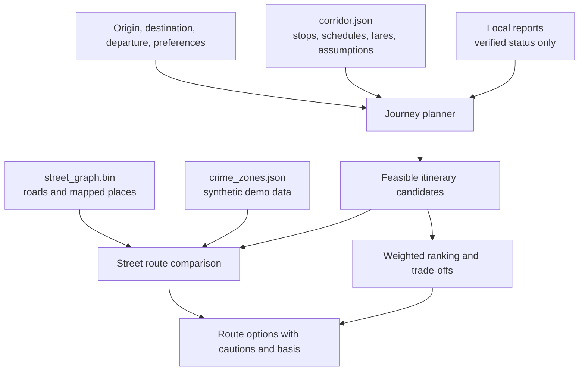
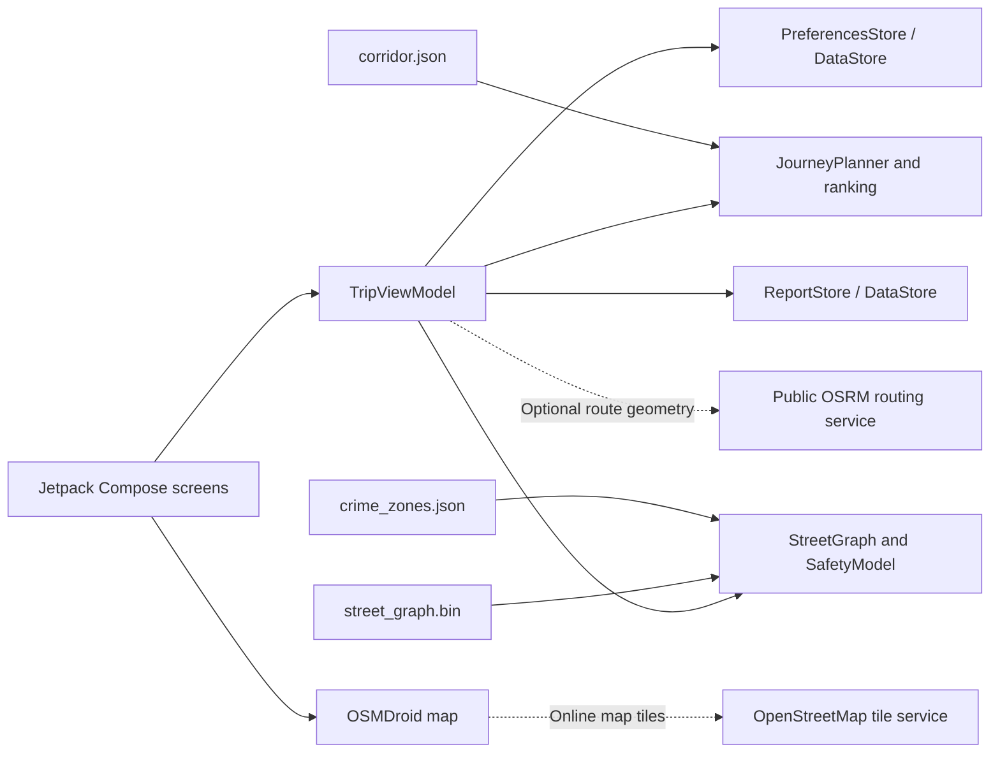
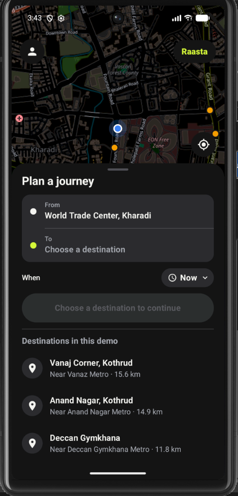
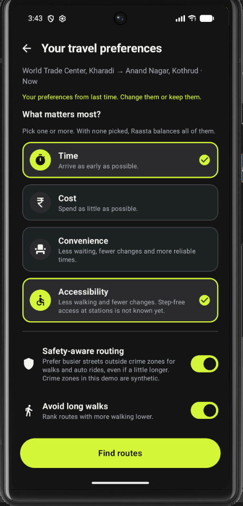
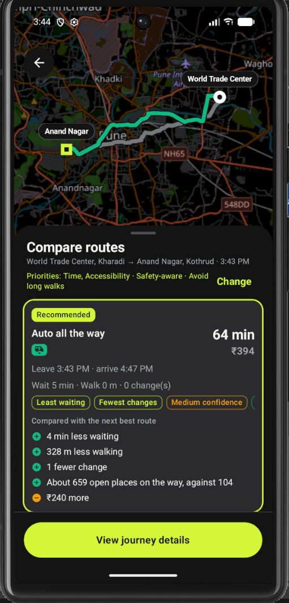
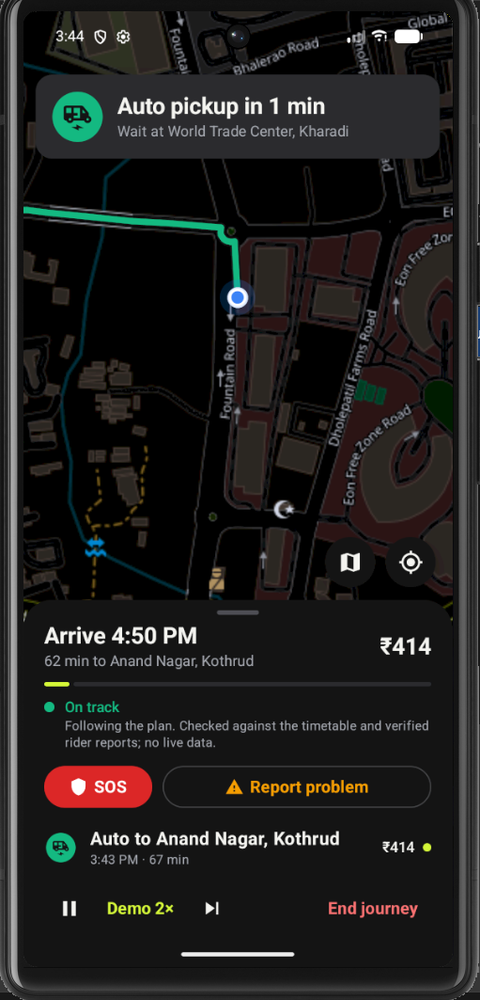

<div align="center">
  
  <h1>Raasta</h1>
  <p><strong>A journey planner for choosing a route and recovering when a connection fails.</strong></p>
  <p>Android demo for the Kharadi–Ramwadi–Aqua Line corridor in Pune</p>
</div>

---

## The journey behind Raasta

For many women, travelling after dark is not a routine calculation of distance and arrival time. It can mean weighing how long a stop may be quiet, whether a connection will still be running, how much walking remains, and what to do if a bus does not arrive. Reduced service, unfamiliar streets, limited nearby activity, and uncertainty about reaching help can make an already ordinary journey feel difficult to assess. These concerns vary by place, time, and individual experience; no route score or map can represent every passenger's circumstances.

A journey planner cannot remove those risks, guarantee that a route is safe, or replace reliable public services and broader measures for public safety. It can, however, make a travel decision easier to understand. A passenger should be able to compare the available options, see which details are sourced and which are estimates, and know what alternatives the plan offers if a connection fails.

Raasta is a prototype built around that narrower, practical purpose. It plans journeys across one Pune corridor using bundled transit and map data, explains the trade-offs between options, and lets a passenger simulate a disruption and compare ways to continue. Its safety-oriented street comparison is an incomplete estimate based on mapped features. It is not a live threat assessment and must not be treated as proof that a route is safe.

## What Raasta is

Raasta is an Android demonstration app for a fixed corridor between Kharadi, Ramwadi, and the Aqua Line metro stations serving Kothrud and Deccan. It combines scheduled bus data, metro assumptions, fare rules, street-network information, and local demo reports to build and rank possible journeys. During a simulated trip, a passenger can report a missed connection and compare recovery options from supported points.

The project explores **explainable trip planning and journey recovery**. It is not a live transit tracker, emergency-response service, or general-purpose map application. This distinction matters: the current data is a collection of snapshots and assumptions, and a recommendation is only as reliable as those inputs.

## At a glance

| | Current demonstration |
|---|---|
| Platform | Android, built with Kotlin and Jetpack Compose |
| Geographic scope | Fixed Kharadi–Ramwadi–Aqua Line corridor in Pune |
| Travel modes | Walking, PMPML bus, Pune Metro, and auto-rickshaw |
| Planning | Compare and rank feasible combinations using trip priorities |
| Recovery | Replan from supported points after a reported disruption |
| Storage | Preferences, demo session, feedback, and reports stored locally with DataStore |
| Live services | No live vehicle locations, transit alerts, GPS tracking, or shared report service |
| Authentication | Local demonstration gate using the fixed code `123456`; no SMS is sent |

## Passenger journey



## Features in the current build

### Plan and compare journeys

- Choose between two bundled origins: World Trade Center, Kharadi, and EON IT Park Phase 2.
- Choose from Vanaj Corner, Anand Nagar, and Deccan Gymkhana as destinations.
- Select a departure time and compare bus-plus-metro, auto-plus-metro, direct-auto, and supported metro options.
- Rank routes using the passenger's selected priorities: time, cost, convenience, and accessibility preference. The accessibility preference changes ranking weights; it does not establish step-free access.
- Review total time, fare, waiting, walking, transfers, confidence, cautions, and route trade-offs.
- Inspect the basis attached to time and fare values, including timetable, official fare, reported value, estimate, or map route.

### Consider walking and street context

- Compare a shortest street path with a safety-oriented alternative for eligible walking and auto legs.
- Use an offline bundled street graph and mapped place information to estimate street activity and route context.
- Display route geometry on an OpenStreetMap-based map when network access and routing geometry are available.
- Treat the safety score as a partial demo estimate. The current implementation includes synthetic crime zones in its safety scoring; those zones are not incident data and say nothing factual about a neighbourhood.

### Continue after a disruption

- Simulate journey progress without claiming to track a real person or vehicle.
- Ask the passenger to confirm bus arrival or boarding because the app has no live bus position.
- Report a missed bus, missed connection, service issue, or delay and compare supported alternatives.
- Recalculate the remaining trip from supported recovery points while retaining the passenger's original preferences.
- Compare added time and fare against the original itinerary and account for fares already paid where applicable.

### Get help and leave feedback

- Open the Android phone dialer for 112 or 1091. The passenger must review and place the call; Raasta does not call automatically.
- Share the simulated trip point through Android's share sheet.
- View a nearby mapped place when one is available in the bundled map data.
- Save trip feedback and route reports on the device. Reports begin unverified; the demonstration can mark them verified or rejected locally. This is not independent moderation or a shared community reporting system.

## How route planning works

The planner builds candidate itineraries from corridor data and fare rules. Each itinerary is represented as a sequence of legs, such as walking to a bus stop, riding a bus to Ramwadi, transferring to the metro, and walking to the destination. It checks service windows, computes waiting and travel time, applies the configured fare rules, and attaches cautions when an input is estimated or unavailable.

Candidates are ranked with a deterministic weighted score. The score considers total time, fare, waiting, walking distance, transfers, and uncertainty. Rider-selected priorities adjust the weights. Matching reports marked verified in the local demo can add a ranking penalty. These weights are hand-set starting assumptions; they have not been validated through a rider study.

When safety-aware routing is enabled, eligible street legs are compared using the bundled street graph, mapped places and activity assumptions, and the synthetic crime layer. Because some inputs are incomplete or synthetic, the resulting score is not evidence of actual crime levels or a personal safety guarantee. Bus and metro legs are not rerouted by the street-safety comparison.



## Data, assumptions, and limitations

Raasta distinguishes between a sourced snapshot, an estimate, synthetic demonstration data, and something it does not know. A source being listed does not mean the source is official, complete, or current.

| Input | Used in the demo | Important limitation |
|---|---|---|
| Bus departures | Bundled community-built static GTFS feed | Not an official live feed. The feed lists few trips after 4 PM; some waits are estimated when no later departure is available. |
| Metro fares | Values transcribed from Pune Metro's published fare chart | The source notes that the chart is undated. |
| Bus fares | Distance slabs attributed to a reported 2025 fare revision | The builder notes that the official Marathi notice was not verified. |
| Auto fares | Reported Pune RTA fare revision and night surcharge | Fare formula is sourced; vehicle availability and traffic are unknown. |
| Metro service | Secondary-source operating window plus assumed average speed and headway | Not an official live timetable; late-train uncertainty is called out. |
| Street graph and places | Bundled OpenStreetMap-derived roads, places, and opening-hour assumptions | Map coverage and tags are incomplete. Online map tiles and some route geometry require internet. |
| Street activity and help | Road types, mapped open places, late-help places, cameras, and transit stops | Estimated from incomplete map data; absence from the map does not mean a place or camera is absent. |
| Crime zones | Synthetic zones generated with a fixed seed | Not incident data or a neighbourhood claim. Current code still includes this layer in safety scores. |
| Live service state | None | The app cannot determine bus location, delay, cancellation, or current metro operations. |
| Rider reports | Device-local reports with unverified, verified, or rejected status | Same-device demonstration controls only; no backend, independent reviewer, or community dataset. |
| Accessibility | A rider preference affecting route ranking | No step-free station, vehicle, or path dataset is available. Accessibility is unknown. |

The bundled corridor file records `generatedOn: 2026-10-23`; individual sources have their own retrieval dates. The synthetic crime asset records generation on 2026-10-24. These dates describe checked-in snapshots, not automatic refreshes. Review the source metadata and resulting diffs before rebuilding or replacing assets.

## Technical architecture

Raasta is an Android application written in Kotlin. Jetpack Compose provides the interface, with a view model coordinating trip state and planner calls. Journey construction, fare calculation, ranking, recovery, street routing, and safety estimates are implemented in focused packages. Preferences, the demo session, and reports use Android DataStore for local persistence.

| Layer | Responsibility | Main location |
|---|---|---|
| App entry and navigation | Activity, Compose app setup, screen flow | `app/app/src/main/java/com/raasta/app/MainActivity.kt`, `RaastaApp.kt` |
| Journey state | Coordinates planning, progress, recovery, and screen state | `app/app/src/main/java/com/raasta/app/ui/TripViewModel.kt` |
| Planner | Corridor models, itinerary construction, fares, ranking, evidence, and data checks | `app/app/src/main/java/com/raasta/app/planner/` |
| Street and safety | Street graph, pathfinding, night activity, safe routes/stops, and safety score | `app/app/src/main/java/com/raasta/app/safety/` |
| Map | OSMDroid presentation, geography, and route shapes | `app/app/src/main/java/com/raasta/app/map/` |
| Local storage | Preferences, demo session, and reports | `app/app/src/main/java/com/raasta/app/store/`, `app/app/src/main/java/com/raasta/app/auth/` |
| Bundled inputs | Corridor snapshot, street graph, and synthetic crime zones | `app/app/src/main/assets/` |
| Data builders | Corridor and street-data generation | `tools/corridor/build_corridor.py`, `tools/safety/build_safety.py` |



The app can build route options from its bundled corridor snapshot. Map tiles and some street or auto route geometry depend on internet access; fallback geometry may be less precise. External routing and tile services do not provide live transit status.

## Visual identity, screenshots, and demonstration video

Raasta uses a dark-first interface with lime green for primary actions, amber for cautions or incomplete evidence, and red for urgent actions. Route cards surface journey metrics and trade-offs; the map remains visible during map-led steps.

<p align="center">
  
</p>

The screenshots below show the current demonstration interface. They illustrate a fixed-corridor planning flow and simulated journey. Route and safety estimates are based on incomplete bundled data; the active journey screen does not track a real vehicle or passenger.

| Journey planning | Travel preferences |
|---|---|
|  |  |

| Route comparison | Active journey simulation |
|---|---|
|  |  |

The safety-aware routing control is based partly on synthetic crime zones, which are not incident data. Accessibility preferences do not confirm step-free access. The active journey's status is simulated and does not use live GPS or vehicle data.

A short demonstration video is available in [`video/raasta_reel.mp4`](video/raasta_reel.mp4).

## Build and run

### Requirements

- Android Studio or a JDK 25 installation
- Android SDK and platform tools
- Android device or emulator
- Android Gradle Plugin 9.3.3 and Gradle 9.5.0 via the included wrapper

The Gradle daemon toolchain is pinned to JDK 25. The Android app has `minSdk 24` and `targetSdk 37`.

### Build and unit tests

From the repository root on Windows PowerShell:

```powershell
cd app
.\gradlew.bat :app:testDebugUnitTest
.\gradlew.bat :app:assembleDebug
```

The debug APK is produced at `app/app/build/outputs/apk/debug/app-debug.apk` relative to the repository root.

To install it on a connected Android device with USB debugging enabled:

```powershell
adb devices
adb install -r .\app\app\build\outputs\apk\debug\app-debug.apk
adb shell monkey -p com.raasta.app 1
```

### Test coverage

Model-level unit tests cover demo authentication, itinerary construction, fare rules, ranking trade-offs, recovery, route finding, night activity, and safety-layer parsing. Test files are under `app/app/src/test/java/com/raasta/app/`.

`connectedDebugAndroidTest` currently contains only an app-context smoke test. It does not exercise the complete UI journey. Persistence and screen flows have limited automated UI coverage. The current checkout has not been verified on a Redmi Note 8 Pro; confirm installation and the full passenger journey on the target device before describing it as device-tested.

The last Gradle attempts in the Codex execution environment did not reach project configuration or run tests. One failed during Java selector wakeup-pipe initialization (`Unable to establish loopback connection`); later sandboxed wrapper invocations were denied access to the Gradle distribution lock under the user profile. These are environment failures and do not establish whether the build or tests pass.

## Refreshing bundled data

The committed `corridor.json`, street graph, and crime zones are snapshots. The builders retrieve public or community data and may require internet access:

- `tools/corridor/build_corridor.py` retrieves the community GTFS feed, OpenStreetMap station data, and public OSRM routes.
- `tools/safety/build_safety.py` retrieves OpenStreetMap data through Overpass.

Rebuilding can change the generated assets. Inspect the recorded sources, retrieval dates, and diffs before replacing committed data. OpenStreetMap-derived data is subject to ODbL attribution requirements.

## Project status and future direction

The current deliverable is a fixed-corridor demonstration. Broader corridor coverage, reliable and regularly refreshed transit feeds, live service integrations, a privacy-conscious shared reporting and moderation model, step-free-access data, stronger UI journey tests, and device validation are future work. Employer or operator mobility dashboards are strategic concepts and are not part of the shipped app.

## Project documentation

- [`docs/PRODUCT_FLOW.md`](docs/PRODUCT_FLOW.md): passenger flow, implemented behavior, and current limitations.
- [`docs/DESIGN.md`](docs/DESIGN.md): interface design system and evidence-language guidance.
- [`tools/safety/README.md`](tools/safety/README.md): safety-data generation details.
- [`docs/brand/raasta-logo.svg`](docs/brand/raasta-logo.svg): project logo.

## License and attribution

OpenStreetMap-derived data is subject to the Open Database License (ODbL). Refer to the source metadata and the applicable attribution requirements when redistributing generated data or app builds. No separate project-wide license file is present in this repository.
