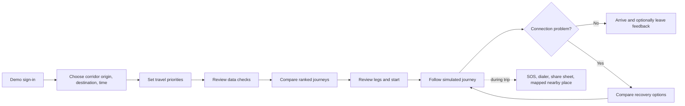
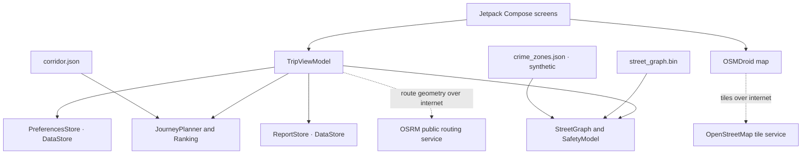

# Raasta

**A Pune journey planner that helps a passenger choose an available route and recover when a connection fails.** Raasta is an Android demo focused on the Kharadi–Ramwadi–Aqua Line corridor. Its product idea is practical journey recovery, not live vehicle tracking or a promise that a route is safe.

Raasta is intended for Pune commuters, including people travelling home after late shifts. The current build is a fixed-corridor demonstration: it compares scheduled bus, metro, and auto combinations, explains where its numbers come from, and lets a passenger try a disruption and see alternatives.

## What works in this build

- Plan from two Kharadi locations to three Kothrud/Deccan destinations.
- Compare bus + metro, auto + metro, and direct-auto journeys when the bundled schedule and operating hours allow them.
- Rank options using time, fare, waiting, walking, transfers, uncertainty, rider-selected priorities, and locally verified reports.
- Inspect source labels, estimates, unknowns, and route trade-offs before choosing.
- Compare shortest and safety-oriented street paths for walking and auto legs.
- Simulate progress, manually confirm whether a bus arrived, and recalculate from supported recovery points.
- Open the phone dialer for emergency numbers, share the simulated trip through Android's share sheet, and view a nearby mapped place.
- Save preferences, feedback, and route reports on the device.

The sign-in is a demo gate: it sends no SMS and accepts the fixed code `123456`. The journey clock is simulated. Raasta has no live PMPML positions, live service alerts, GPS tracking, general address search, report server, or step-free-access dataset.

## Passenger journey



The journey flow and visual language described here reflect the current Android demo.

> The repository-root `design.md` is an unrelated design document and is not authoritative for this Android app.

## What the recommendation uses

| Information | What Raasta currently has | How to interpret it |
|---|---|---|
| Bus departures | A bundled community-built static GTFS feed | Not an official or live feed; the source notes few listed trips after 4 PM. Some waits are estimates when the feed has no later trip. |
| Metro fares | Values transcribed from Pune Metro's published fare chart | Source is listed in the bundled corridor file; the chart is described there as undated. |
| Bus fares | Distance slabs from a reported 2025 fare revision | The builder notes that the official Marathi notice was not verified. |
| Auto fares | A reported Pune RTA fare revision and night surcharge | Fare formula is sourced; auto availability and traffic are unknown. |
| Metro hours/headway | Secondary-source service window and assumed average speed/headway | Not an official live timetable; late-train uncertainty is called out. |
| Street geometry and places | Bundled OpenStreetMap-derived network, places, and opening-hour assumptions | Coverage and tags are incomplete; runtime map tiles and some walking/auto geometry require internet. A straight-line fallback can be used when route geometry is unavailable. |
| Street activity/help | Road type, mapped open places, late-help places, cameras, and transit stops | Estimated from incomplete map data; unmapped places and cameras may exist. It is not a measurement. |
| Crime zones | Synthetic demo zones generated from a fixed seed | They are not incident data or a neighbourhood claim. **Current code still feeds this layer into safety scores**, so those scores must be treated as demo estimates, not evidence of real crime. |
| Live service state | No live feed | Marked unknown; Raasta does not know where a bus is or whether a service is delayed. |
| Rider reports | Local reports with unverified/verified/rejected status | In this demo the rider can review reports on the same device. This is not independent moderation or a shared community dataset. Only reports marked verified affect ranking. |

The bundled corridor file records `generatedOn: 2026-10-23`; each source also carries its own retrieval date. The synthetic crime asset records generation on 2026-10-24. These dates describe the checked-in snapshots, not a live refresh.

The planner's weights are hand-set starting assumptions, not weights validated through a rider study. A high safety score is not a safety guarantee. The safety-data limitations are summarized above.

## Architecture



The Android project is under [`app/`](app/), which is the Gradle root. The app module contains the Compose UI and packaged assets. Pure planner, fare, recovery, and street-routing logic is unit-tested; persistence and screen flows have little automated UI coverage.

### Main code areas

| Area | Files |
|---|---|
| App entry and navigation | `app/app/src/main/java/com/raasta/app/MainActivity.kt`, `RaastaApp.kt` |
| Journey state and orchestration | `app/app/src/main/java/com/raasta/app/ui/TripViewModel.kt` |
| Corridor models and itinerary planning | `app/app/src/main/java/com/raasta/app/planner/` |
| Street graph, crime layer, crowd and routing | `app/app/src/main/java/com/raasta/app/safety/` |
| Map and route shapes | `app/app/src/main/java/com/raasta/app/map/` |
| Local preferences and reports | `app/app/src/main/java/com/raasta/app/store/` |
| Bundled corridor and street assets | `app/app/src/main/assets/` |
| Data generation | `tools/corridor/build_corridor.py`, `tools/safety/build_safety.py` |

## Build, test, and install

Requirements: Android Studio or a JDK 25 installation, Android SDK/platform tools, and an Android device or emulator. The wrapper is Gradle 9.5.0, the Android Gradle Plugin is 9.3.3, and the repository's Gradle daemon toolchain is pinned to JDK 25. The Android module has `minSdk 24` and `targetSdk 37`.

From the repository root on Windows:

```powershell
cd app
.\gradlew.bat :app:testDebugUnitTest
.\gradlew.bat :app:assembleDebug
```

The debug APK output is `app/app/build/outputs/apk/debug/app-debug.apk` relative to the repository root. Install it on an attached device with USB debugging enabled:

```powershell
adb devices
adb install -r .\app\build\outputs\apk\debug\app-debug.apk
adb shell monkey -p com.raasta.app 1
```

No app behavior has been verified on a Redmi Note 8 Pro in this checkout. Confirm installation and the complete journey on the target phone before presenting it as device-tested.

Useful unit-test groups:

- `DemoAuthTest` — demo phone and OTP validation.
- `JourneyPlannerTest`, `FareRulesTest`, `JourneyFlowTest` — itinerary, fare, ranking, data checks, and trade-offs.
- `RecoveryTest` and the recovery cases in `JourneyFlowTest` — missed bus/metro alternatives and comparison with the original plan.
- `RouterTest`, `NightActivityTest`, `JourneySafetyTest`, `CrimeLayerTest` — street routes, safety estimates, synthetic crime parsing, and night activity.

`connectedDebugAndroidTest` currently contains only the Android app-context smoke test. It is not a UI journey test suite.

## Data refresh and scope

The committed `corridor.json`, street graph, and crime zones are snapshots. `tools/corridor/build_corridor.py` retrieves the community GTFS feed, OpenStreetMap station data, and public OSRM routes; `tools/safety/build_safety.py` retrieves OpenStreetMap data through Overpass. Rebuilding requires internet access and can change the generated assets. Review source dates and diffs before replacing bundled data. OpenStreetMap data is subject to ODbL attribution requirements.

The product's strategic north star is broader than this demo: reliable recovery on one corridor first, then wider corridor coverage and trustworthy, privacy-conscious reporting. A mobility dashboard for employers/operators and live transit integrations are future concepts, not shipped features.

## Current verification status

The last Gradle attempts in the Codex execution environment did not reach project configuration or execute tests. One run failed in Java's selector wakeup-pipe initialization (`Unable to establish loopback connection`); subsequent sandboxed wrapper invocations were denied access to the Gradle distribution lock under the user profile. These are environment failures, not evidence that the build or tests pass. Run the commands above in a normal Android Studio/Windows build environment and record the result before release.

No screenshots from a verified current build are tracked yet. Add device screenshots only after checking that their screens match the source and their demo data is clearly labelled.
