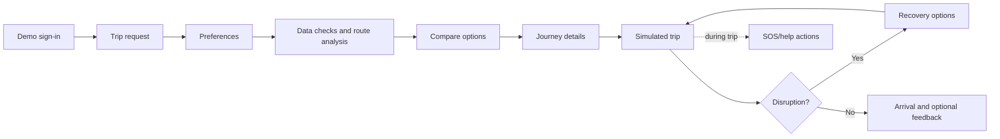

# Raasta passenger flow and implementation contract

This document describes what the current Android demo does, where its data comes from, and what should happen when an input or source is missing. “Implemented” below means present in the current local source; it does not mean the flow has been validated on a physical phone.

## At a glance

## 1. Demo entry

- **Entry condition:** App has no saved demo phone session.
- **Passenger action:** Enter a 10-digit Indian mobile number and the on-screen fixed OTP `123456`.
- **App response:** Validates the number and code locally, masks the number in the account sheet, and saves the session with DataStore.
- **Data required:** None beyond the entered demo number; no SMS or remote authentication service is called.
- **Empty/error/recovery:** Invalid number is rejected inline; incorrect code shows an inline error and permits changing the number. This is not production authentication.
- **Next:** Home trip map.
- **Relevant tests:** `DemoAuthTest` (`acceptsTenDigitMobileStartingWithSixToNine`, `rejectsInvalidMobiles`, `onlyTheDemoCodeVerifies`, `masksAllButLastFourDigits`). There is no Compose login-flow test.

## 2. Enter the trip

- **Entry condition:** Demo session exists; corridor asset has loaded.
- **Passenger action:** Keep or change the starting point, choose a destination, and keep “Leave now” or choose a departure time.
- **App response:** Shows the corridor map and bundled places. The initial origin is World Trade Center, Kharadi. Available origins are WTC and EON IT Park Phase 2; destinations are Vanaj Corner, Anand Nagar, and Deccan Gymkhana. Continue stays disabled until a destination is chosen.
- **Data required:** `corridor.json`; it contains the Kharadi–Ramwadi–Aqua Line corridor, fixed station/stop coordinates, and the generated schedule/fare snapshot.
- **Empty/error/recovery:** Search only filters bundled corridor suggestions; no matching suggestion is shown for an unknown place. Arbitrary addresses and current GPS are not supported. There is no explicit fallback if required `corridor.json` cannot be decoded.
- **Next:** Travel preferences.
- **Relevant tests:** `JourneyPlannerTest` covers itinerary construction downstream. No screen test covers destination selection or the no-match state.

## 3. Choose preferences and calculate options

- **Entry condition:** Origin, destination, and departure time are available.
- **Passenger action:** Choose one or more priorities (time, cost, convenience, accessibility), switch safety-aware routing on/off, and optionally avoid long walks.
- **App response:** Saves preferences locally. With no selected goals, ranking uses the balanced weights; default `TravelPreferences` otherwise starts with time as the only goal. On a night trip with no saved preference, safety-aware routing is initially enabled. The route-analysis page shows checks and lets the passenger continue when analysis is complete.
- **Data required:** Static GTFS departures; fare tables and service assumptions from `corridor.json`; source retrieval dates; local verified reports; the offline street graph when safety comparison is enabled.
- **How ranking works:** A deterministic weighted score uses total time, fare, waiting, walking distance, transfers, and uncertainty; verified matching local reports add penalties. When enabled, street comparison adjusts the itinerary ranking after its shortest/safety variants are calculated. These are hand-set demo weights, not learned preferences or user-study findings.
- **Empty/error/recovery:** Itineraries outside metro operating hours are listed as unavailable. Unknown live service state, auto availability, and step-free access are exposed as unknown. If street-safety data cannot load, normal trip options still work without a safety comparison. If no usable journey remains, the comparison action is unavailable and the no-options message is shown.
- **Next:** Compare feasible routes.
- **Relevant tests:** `JourneyPlannerTest`, `FareRulesTest`, `JourneyFlowTest` (balanced preferences, unknown/outdated checks, and trade-offs), plus the routing tests in the next stage. No Compose test covers the staged check page.

## 4. Compare and understand routes

- **Entry condition:** At least one feasible option has been ranked.
- **Passenger action:** Select the recommended option or an alternative; compare time, fare, wait, walking, transfers, confidence, cautions, and explanation; change preferences or open full details.
- **App response:** Ranks the best score first, labels route highlights, and explains trade-offs against the next-best option. Per-leg fare/time bases and cautions are shown in details. The map can display the route. With safety-aware mode enabled, walking/auto legs can offer shortest and safety-oriented street variants.
- **Data required:** Same itinerary data plus street graph/place hours and the synthetic crime asset for current safety scoring. Public OSRM routing can provide route geometry; a fallback path is used if it is unavailable. Bus/metro legs do not use street safety rerouting.
- **Empty/error/recovery:** Metro-unavailable candidates show service hours. If the safety graph is missing/broken, normal routes are retained and the app says safety data is unavailable. If a street variant cannot improve the route enough or exceeds the detour limit, the shortest path is kept. Crime zones are synthetic and **currently affect the score despite being marked demo**; scores are not real crime evidence or a guarantee.
- **Next:** Review the selected itinerary and start the demo trip.
- **Relevant tests:** `JourneyFlowTest.tradeoffsNameWhatIsBetterAndWorse`, `RouterTest`, `NightActivityTest`, `JourneySafetyTest`, and `CrimeLayerTest`. These are model-level tests, not map UI tests.

## 5. Review details and start

- **Entry condition:** A route is selected.
- **Passenger action:** Read the itinerary legs, start/arrival time, total time and fare, trade-offs, confidence/cautions, and street choice; tap Start.
- **App response:** Starts a simulated trip clock, records the original option, and loads map/route shapes. The chosen journey is preserved for later recovery comparison.
- **Data required:** Planned itinerary, route shapes, bundled place coordinates, and optional street comparison.
- **Empty/error/recovery:** Online map tiles and routing geometry may be unavailable; geometry falls back to bundled/straight-line paths where possible. This does not create live service status.
- **Next:** Active journey.
- **Relevant tests:** Planner and route-geometry calculations are covered in `JourneyPlannerTest` and `JourneySafetyTest`; no screen test validates the full start flow.

## 6. Follow the active journey

- **Entry condition:** Passenger starts an itinerary.
- **Passenger action:** Follow the current leg, confirm a bus arrived/boarded when prompted, pause/resume the demo clock, change demo speed, skip ahead, report a problem, or end the trip.
- **App response:** Moves a simulated position along the selected route and shows current instructions and estimated status. A bus-arrival prompt explicitly asks the passenger because there are no live bus positions. Reaching the planned end opens feedback; ending early returns to trip search without the arrival flow.
- **Data required:** Planned leg times, static route shapes, and optional verified local reports. No GPS permission or live vehicle feed is used.
- **Empty/error/recovery:** On a bus/auto while moving, recovery is deferred until the next stop. If map routing is offline, fallback geometry may be less precise. “On track” is a state of the demo plan, not an observation of a real vehicle.
- **SOS/help actions:** Opens dialer intents for 112 and 1091 (the passenger must press Call), Android's share sheet with the current simulated trip point, and a map route to a nearby mapped place when one is found. This is not an automatic emergency call or live-location tracking.
- **Next:** Continue, recover at a supported stop, arrive, or end early.
- **Relevant tests:** `JourneyFlowTest` and `RecoveryTest` cover the underlying progress/recovery model. There are no Compose tests for boarding, status, SOS, or simulated-position display.

## 7. Recover from a disruption

- **Entry condition:** Passenger reports a bus that did not come, a missed connection, a service unavailable, or running late.
- **Passenger action:** Choose the matching problem and review the alternatives; keep the current plan or select a reroute.
- **App response:** Replans the remaining trip from the current supported recovery point/time, using the original preferences and verified reports. The comparison shows added/avoided time and fare against the original plan and accounts for fares already paid. For an eligible failed bus, the failed departure is skipped and the planner can compare waiting for a later bus, other routes, metro access, and direct auto.
- **Data required:** The five bundled recovery points, destination, remaining static departures, metro service assumptions, fare rules, original preferences, and simulated current time.
- **Empty/error/recovery:** Returns an explicit reason when the passenger is aboard a moving vehicle, already on the last leg, or at a location outside the recovery data. If metro service is reported unavailable, the transfer recovery omits metro and offers auto where supported. “Running late” is a user report; the app does not detect lateness itself.
- **Next:** Resume the new remaining journey or keep the existing plan.
- **Relevant tests:** `RecoveryTest` (`keepWaitingSkipsTheBusThatJustFailed`, `failedRouteIsOfferedOnlyOnceAndOnlyWhereTheRiderIs`, `otherRoutesBoardAtTheNearestStopServingThem`, `lateEveningRecommendsSwitchingAndSaysWhatItCosts`, `noComparisonWhenWaitingIsTheBestOption`) and `JourneyFlowTest` recovery cases.

## 8. Arrival, rating, and route reports

- **Entry condition:** The simulated journey reaches its destination, or the passenger later opens reports from the account menu.
- **Passenger action:** Optionally rate the journey and select route conditions with a stop/station/place. Submit feedback or move on to another trip.
- **App response:** Stores ratings and reports locally in DataStore. Reports start unverified. The report screen displays status and permits demo verify/reject actions on the same device. Only reports marked verified are converted to ranking evidence.
- **Data required:** User-selected rating/condition/place and the original journey label.
- **Empty/error/recovery:** Feedback is optional; reports with no selected condition are not created. There is no backend, independent reviewer, sync, anonymisation pipeline, or export flow. Do not describe these reports as community-verified in the current demo.
- **Next:** Plan another trip or review locally stored reports.
- **Relevant tests:** `JourneyFlowTest.verifiedReportPushesAffectedRouteDown` tests the ranking effect; no test currently covers DataStore persistence, reviewer UI, or feedback submission UI.

## Evidence and uncertainty rules

| Category | Current examples | Product language |
|---|---|---|
| Sourced snapshot | Metro fare chart, reported auto rates, community GTFS, OSM network | Include source and retrieval date; a source being listed does not make it current or official. |
| Estimate/assumption | Some bus waits, metro headway/speed, auto availability, open-hours fallback | Label as estimate and show the assumption. |
| Synthetic | Crime polygons in `crime_zones.json` | Label synthetic, never imply real neighbourhood incidents. Current code still scores it; fix before claiming evidence-first routing. |
| Unknown | Live bus position/service state, auto availability, step-free accessibility | Say unknown; do not invent a value. |
| Unverified user input | New route report | Keep out of ranking until verified; explain the current reviewer is only a local demo control. |

## Most important next work

1. Exclude synthetic crime zones from route scores, while retaining their clearly labelled map visualization; add regression tests that compare against no crime data.
2. Establish a repeatable Gradle build/test path and validate the full journey on a physical Android phone, including the Redmi Note 8 Pro.
3. Replace or qualify sparse/unofficial schedule data and add a freshness process before relying on the product for real trips.
4. Add Compose tests for the journey flow, unavailable/loading states, recovery, and the SOS handoff.
5. Replace same-device report review with an explicitly designed, privacy-reviewed moderation model before calling reports verified outside the demo.
6. Keep corridor coverage, accessibility, and live-service work separate roadmap items; do not imply they are available until data and tests exist.
